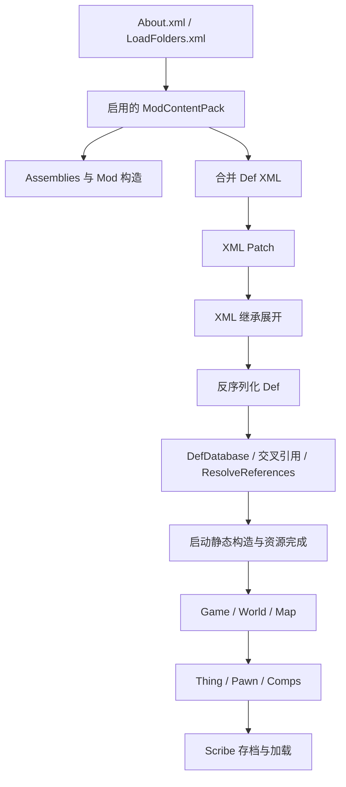

# 架构与生命周期

## 数据、实例与管理器

| 层 | 主要类型 / 命名空间 | 开发时的含义 |
|---|---|---|
| 引擎兼容与渲染 | Waylith、UnityEngine 兼容类型 | 不直接承担殖民地业务状态；新渲染代码必须核实实际 API |
| 基础游戏框架 | `Verse` | Def、Thing、Pawn、Map、读写档、内容加载、UI、工具类 |
| 玩法系统 | `RimWorld` | 工作、需求、心情、事件、科技、建筑功能、派系等 |
| AI | `Verse.AI`、`Verse.AI.Group` | Job、Toil、寻路、ThinkTree、Lord 群体行为 |
| 世界层 | `RimWorld.Planet` | World、WorldObject、Caravan、PlanetTile；不是地图格子 |
| 元定义 | `Def` 及子类、`DefDatabase<T>` | 加载期共享配置。实例通过 `def` 引用它 |
| 实体 | `Thing` → `ThingWithComps` → Building/Pawn 等 | 每个实体自己的状态；未必已生成在地图上 |
| 容器与所有权 | `IThingHolder`、`ThingOwner` | 背包、容器、运输中物品等；不能把所有 Thing 都当成地图实体 |
| 游戏会话 | `Current.Game`、`GameComponent` | 一局游戏的全局状态，跨地图 |
| 世界 | `World`、`WorldComponent` | 与世界对应的状态 |
| 地图 | `Map`、`MapComponent` | 单张地图的数据、索引和处理逻辑；一局可以有多张地图 |

`ThingDef` 与 `Thing`、`HediffDef` 与 `Hediff`、`JobDef` 与 `Job` 是配置和实例的关系。不要把每个 Pawn 的冷却、进度或目标塞到共享 Def / CompProperties / worker 实例中。

## 启动次序：已核实的关键节点

依据：`LoadedModManager.LoadAllActiveMods` 与 `PlayDataLoader.DoPlayLoad`。下面省略了翻译、implied Def、短哈希、图集等穿插步骤，不能把它当成逐行调用栈。

1. 根据启用顺序创建 `ModContentPack`、选择内容目录、加载程序集；资源工作也可能排入 `LongEventHandler`。
2. `CreateModClasses` 实例化 `Verse.Mod` 子类，传入所属 `ModContentPack`。**此时 Def XML 尚未读入。**
3. 收集 Def XML，合并成一个 `<Defs>` DOM；对该 DOM 按 mod 顺序应用 XML Patch。
4. 注册并解析 XML 继承，再创建 Def 对象。本地 1.7 默认走 `DirectXmlToObjectNew`；`-legacy-xml-deserializer` 才选择旧加载器。
5. Def 加入全局数据库，解析交叉引用；DefOf 有早期和最终绑定；生成 implied Def 并调用 `ResolveReferences` 等初始化。
6. 加载队列结束回调中执行带 `[StaticConstructorOnStartup]` 的静态构造，完成资源和图集等后续工作。
7. 新游戏或读档创建 Game/World/Map、实例和组件，进入模拟。

`Mod` 构造适合读设置、注册 Harmony、记录 Content；不要在这里缓存 `DefDatabase`、访问 `Find.CurrentMap` 或读 Pawn。启动静态构造适合已加载的 Def 和共享资源缓存，但没有正在游玩的地图。需要地图/会话对象的数据放到对应组件的初始化回调。

## 选择扩展点

| 需求 | 默认入口 | 应避免的做法 |
|---|---|---|
| 调整数值/引用/已有功能 | Def 字段、`statBases`、XML Patch | 为一个数值 patch 全局 getter |
| 某类物品或建筑增加功能 | `ThingComp` + `CompProperties` | 为每个对象存一个静态字典而不清理 |
| 自定义实体本体 | `thingClass` 子类 | 忽略基类 Spawn/Destroy/ExposeData 行为 |
| 健康状态附加逻辑 | `HediffComp` + `HediffCompProperties` | 每 tick 在全部 Pawn 中找目标 |
| 地图索引/周期处理 | `MapComponent` | 用 `Find.CurrentMap` 代表组件所属地图 |
| 世界 / 会话状态 | `WorldComponent` / `GameComponent` | 用 static 跨存档持有实例 |
| 可配置数据附着在 Def 上 | `DefModExtension` | 用于保存运行时状态 |
| 生产、手术、事件、心情 | Recipe/Incident/Thought/Stat worker | 把 worker 当成每次事件新建的实例 |
| 原版无公开扩展点的行为 | Harmony | 用大范围 Prefix 完整替换整个系统 |

## 时间、delta 与线程

`GenTicks` 常量：每游戏秒 60 tick，Rare 250，Long 2000，当前 `MaxTickInterval=15`。这些是模拟单位，不是 FPS；加速可能提高现实每秒处理量，性能不足时也可能达不到目标。

`ThingWithComps.Tick()` 调用 `CompTick()`；`TickInterval(int delta)` 调用 `CompTickInterval(delta)`；`TickRare()` 调用 `CompTickRare()`。三条路径独立存在。是否获得某条回调取决于实体注册和调度；普通物体用 `tickerType`，Pawn 等系统还有自己的处理链。

- 使用 delta 回调时，进度按 `delta` 累加，或使用 `IsHashIntervalTick(interval, delta)` / `GenTicks.IsTickIntervalDelta`。只用取模等于零可能错过跨过的时刻。
- 原版正常 tick、interval tick 和兼容处理都存在；迁移 override 前查调用者，不要同时在两处叠加同一效果。
- Rare/Long 适合粗粒度逻辑；不要给 `tickerType=Never` 的对象写 CompTick 然后期待被调用。
- UI 的 Update/OnGUI/Draw 是显示入口。不要从绘制、标签、属性查询或思想查询中扣资源、改存档状态或消耗随机数。
- 不能因为换了 .NET 就把游戏对象随意放进 `Task.Run`。地图集合、Scribe 和资源通常有线程约束；加载器内部也存在并行阶段。先查调用上下文，对共享缓存作相应同步。

## 实体状态与清理

- `Spawned` 表示当前生成在地图上；`Map` 在未生成时可以为空；`MapHeld` / `PositionHeld` 用于沿持有链查询，需要明确业务是否接受容器中的对象。
- `DeSpawn` 是离开地图，不等于 `Destroy`。转移、装载、最小化、持有关系变化都可能使缓存失效。
- ThingComp 可在 `PostSpawnSetup` 注册地图索引，在 `PostDeSpawn(Map, DestroyMode)` / `PostDestroy` 撤销；地图卸载也应清理索引。
- `respawningAfterLoad` 为真时不要再次发放初始物品或重置持久化进度。
- static 缓存只保存稳定配置或有明确失效策略的数据；新游戏、读另一份存档、Def 热重载后不要保留旧地图/实体引用。

持久化初始化顺序和构造签名见 [persistence.md](persistence.md)，已核实的覆盖方法见 [csharp-api.md](csharp-api.md)。
